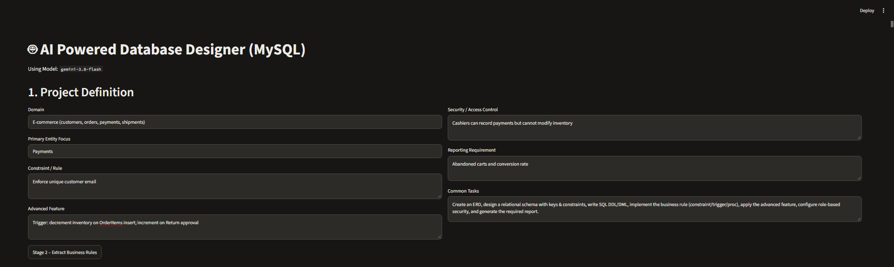
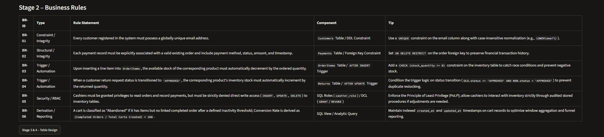
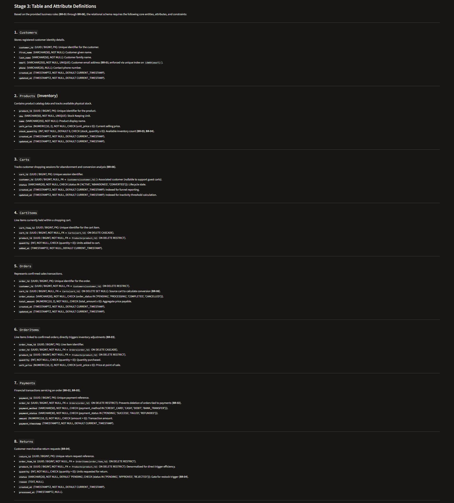
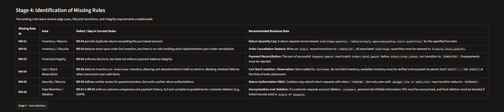
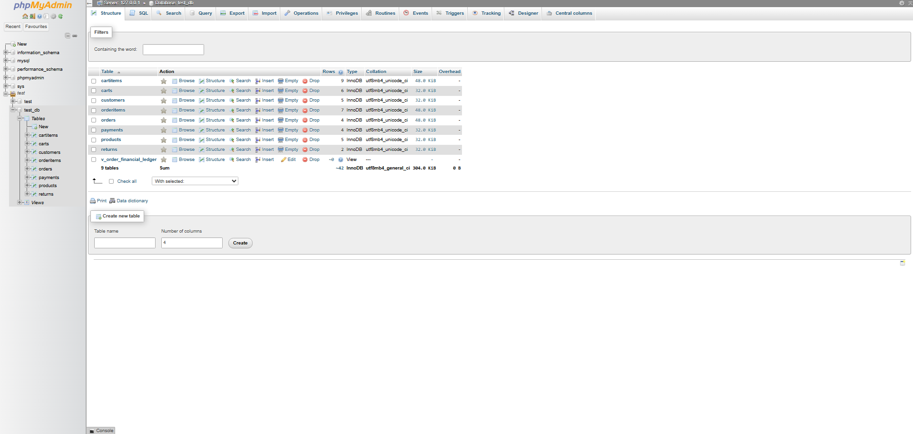

# AI Assisted Database Designer

Turn a project brief into a relational database design. This Streamlit app uses Gemini to extract business rules, propose tables and keys, normalize the schema, draw an entity relationship diagram (ERD), and generate a SQL script for MySQL 8. Each stage uses the output of an earlier stage, so you can review the design as it develops.

## Run locally

You need Python with pip and a Gemini API key. The design stages and SQL download work without a running database. The optional deployment step requires a local database server.

In PowerShell, run:

```powershell
git clone https://github.com/BerkeEfeKendirli/ai-assisted-database-designer.git
cd ai-assisted-database-designer
python -m venv .venv
.\.venv\Scripts\python.exe -m pip install -r requirements.txt
Copy-Item .env.example .env
notepad .env
```

Set `GEMINI_API_KEY` in `.env` to your own key. To choose another model, change `GEMINI_MODEL` in the same file. Save it and start the app:

```powershell
.\.venv\Scripts\python.exe -m streamlit run app.py
```

Open the local URL printed by Streamlit. Each generation button sends the relevant requirements or design output to Gemini.

## Walkthrough

### 1. Define the project

Enter the domain, primary entity, constraints, advanced features, access rules, reporting needs, and tasks. In this example, payments are the focus. Customer emails must be unique, order items reduce inventory, approved returns restore it, and cashiers can record payments without changing inventory. The requested report covers abandoned carts and conversion rate.



### 2. Extract business rules

Select **Stage 2 – Extract Business Rules**. Each row connects a requirement to a database component. For example, email uniqueness belongs in a constraint, while the stock adjustment on a return depends on a change in approval status.



### 3–4. Review tables and missing rules

Select **Stage 3 & 4 – Table Design** to generate both outputs. First, inspect the proposed tables, columns, and keys.



Then review the assumptions the brief leaves open, such as whether the total returned quantity can exceed the quantity purchased.



### 5–7. Normalize, draw the ERD, and generate SQL

Select **Stage 5 – Normalization** to see the design through third normal form. **Generate ER Diagram (Visual)** renders the normalized schema with Graphviz. Finally, **Generate SQL Scripts (MySQL)** produces a script you can review and save with **Download SQL**.

[View all seven stages in one full-length screenshot](docs/screenshots/fullsteps.png)

### Optional local deployment

Start the database server, enter a database name, and select **Deploy Database**. The current connector uses `localhost`, user `root`, and an empty password. Review the generated SQL before running it against a disposable local database. Check any **Skipped** warnings after deployment, since the app continues when an individual statement fails.


